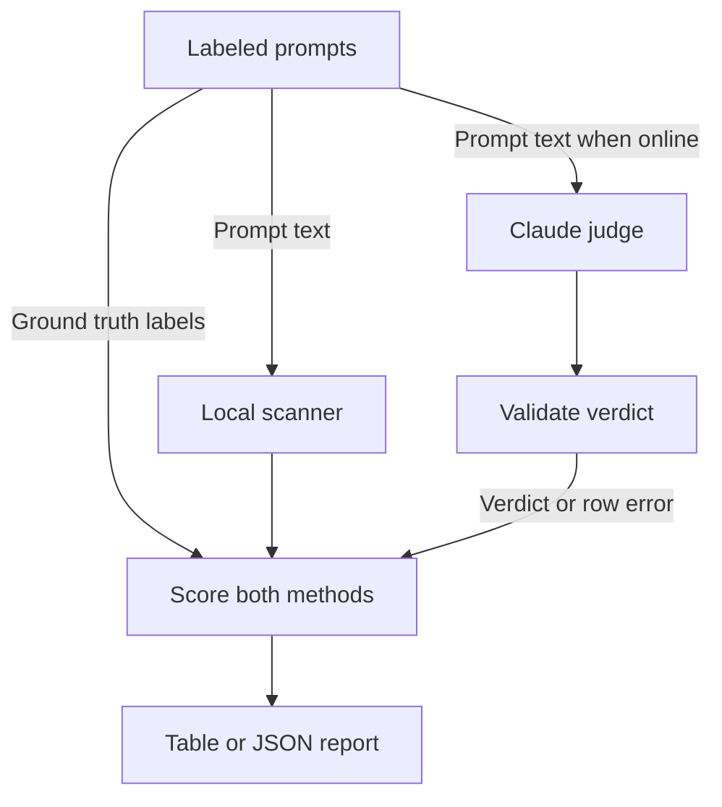

#   Ai-security-prompt-injection-Detector


Run a local scanner on 30 labeled prompts, then optionally compare its decisions with Claude’s. The benchmark shows which prompts each method flags, where it misses an injection, and how much of the dataset each method scored.

## 1. The problem

A detector has to recognize attempts to redirect a model while keeping false alarms low. A rule can identify familiar wording and explain exactly which pattern matched. Assessing a request in context is harder. This project puts those decisions side by side so you can evaluate them against the same labels.

| Signal | What the local scanner checks |
| --- | --- |
| Instruction overrides | Familiar wording that asks the model to disregard or replace instructions |
| Role-play framing | Known phrases that ask the model to act outside its usual constraints |
| Fake message boundaries | Text that resembles a system message or context delimiter |
| Encoded text | Recognized phrases in printable Base64 or hex decodes |

## 2. Core concepts

- **Prompt injection** occurs when input steers a language model away from its intended instructions. Direct injection comes through a user prompt. Indirect injection comes through content the model reads, such as a document or webpage.
- **Heuristic detection** uses predefined rules. A match provides an explanation you can inspect in the report.
- **Structured verdicts** give Claude a schema for `is_injection`, `confidence`, and `rationale`. The Python evaluator validates the returned fields before it scores the row.
- **Precision** measures how many flagged prompts carry an injection label. **Recall** measures how many prompts with an injection label were flagged.

## 3. Architecture



The dataset supplies a prompt and a ground truth label for each row. Each classifier receives the text. The evaluator keeps the label for scoring. In an online run, Claude sees every prompt, including those flagged by the scanner. In an offline run, the evaluator uses the local scanner and skips the provider request.

## 4. Phased roadmap

| Phase | Focus | What you learn |
| --- | --- | --- |
| 0 | Run the benchmark | Establish a reproducible local baseline. |
| 1 | Read the rules | Trace a flag back to the code that produced it. |
| 2 | Inspect the labels | Identify false positives and false negatives. |
| 3 | Follow a Claude verdict | Validate model output before using it in an evaluation. |
| 4 | Interpret the report | Compare scores and check how many inputs each method covered. |

<details>
<summary><strong>Phase 0 · Run the benchmark</strong></summary>

Start with the offline command in [Setup and run](#6-setup-and-run). It uses Python’s standard library and reads the bundled dataset from the project directory.

**Checkpoint** Look for `Model status: offline` and `30/30` in the local scanner’s `Scored` column.

</details>

<details>
<summary><strong>Phase 1 · Read the rules</strong></summary>

Follow `scan()` in [`src/heuristics.py`](src/heuristics.py). It checks the four pattern families and records the matched rule labels. The JSON report includes `matched_patterns` for each offline row.

**Checkpoint** Compare the pattern labels on a flagged row with the empty list on a benign row.

</details>

<details>
<summary><strong>Phase 2 · Inspect the labels</strong></summary>

The dataset includes 15 benign prompts and 15 labeled injections. Each record in [`data/labeled_prompts.json`](data/labeled_prompts.json) has an `id`, a `label`, and `text`.

**Checkpoint** Look up `i15` by ID in the benchmark result. It is the paraphrased example that the local rules miss.

</details>

<details>
<summary><strong>Phase 3 · Follow a Claude verdict</strong></summary>

[`src/model_judge.py`](src/model_judge.py) puts the supplied text inside classification tags and asks Claude for a `report_verdict` tool result. It checks for a single complete call, a boolean decision, an allowed confidence label, and a rationale of at most 300 characters.

**Checkpoint** Read the [mocked judge tests](tests/test_model_judge.py) to see how invalid verdicts and timeouts affect an evaluation.

</details>

<details>
<summary><strong>Phase 4 · Interpret the report</strong></summary>

[`src/main.py`](src/main.py) counts true positives, false positives, false negatives, and true negatives for classified rows. For the model comparison, `evaluated` and `total` show how many rows contribute to the metrics.

**Checkpoint** If a model run is partial, read the coverage counts and the row errors before comparing its scores with the local scanner.

</details>

## 5. Prerequisites

- **Python 3.10 or newer** for the local benchmark and tests.
- **Git** to clone the repository.
- **An Anthropic API key and the packages in `requirements.txt`** for the optional online comparison.

## 6. Setup and run

### Run offline

```bash
git clone https://github.com/ChanduKomme/prompt-injection-detector.git
cd prompt-injection-detector
python3 src/main.py --offline
```

### Save the JSON report

```bash
python3 src/main.py --offline --json > report.json
python3 -m json.tool report.json
```

With `--json`, standard output contains one JSON document. Diagnostics go to standard error. Each row includes the fixture ID, label, and predicted flag.

### Enable the optional Claude comparison

```bash
python3 -m venv .venv
source .venv/bin/activate
python3 -m pip install -r requirements.txt
cp .env.example .env
```

Set `ANTHROPIC_API_KEY` in `.env` or your process environment. The project loads `.env` from its root, and exported variables take precedence. `ANTHROPIC_MODEL` selects the model and defaults to `claude-opus-5`.

```bash
python3 src/main.py
```

| `model_status` | Meaning |
| --- | --- |
| `offline` | You selected the local-only run. |
| `complete` | Claude returned a valid verdict for every row. |
| `partial` | Claude scored some rows. Metrics cover those rows. |
| `unavailable` | Setup failed or Claude returned zero usable verdicts. |

The `heuristic` object contains the local results. The `model` object is `null` in offline mode or when online setup fails. If a model run starts, each unscored row has `model_flagged: null` and an `error`. Use `evaluated` and `total` to track coverage in automated runs.

### Verified offline results

| Method | Scored | Precision | Recall | TP | FP | FN | TN |
| --- | ---: | ---: | ---: | ---: | ---: | ---: | ---: |
| Local scanner | 30/30 | 100% | 93.3% | 14 | 0 | 1 | 15 |

With 15 labeled injections, a single verdict changes recall by about 6.7 percentage points. Estimate performance on new inputs with a separate evaluation set that reflects actual traffic.

### Run the tests

```bash
python3 -m unittest discover -s tests -t .
```

All 22 tests pass locally. They cover rule matching, decoding, scoring, JSON output, and model response handling. The Claude tests use local stubs. Running the configured online comparison measures live model performance.

### Repository layout

| Path | Purpose |
| --- | --- |
| [`src/heuristics.py`](src/heuristics.py) | Detection rules and match explanations |
| [`src/model_judge.py`](src/model_judge.py) | Claude configuration, API request, and verdict validation |
| [`src/main.py`](src/main.py) | Dataset loading, scoring, and command-line reporting |
| [`data/labeled_prompts.json`](data/labeled_prompts.json) | 30 labeled prompts used in the benchmark |
| [`tests/`](tests/) | Scanner, scoring, CLI, and model regression tests |
| [`.env.example`](.env.example) | Configuration template for the optional API comparison |
| [`requirements.txt`](requirements.txt) | Dependencies for online mode |

## 7. Security considerations

- **Use verdicts for triage.** Even a schema-valid verdict can misclassify the input. Enforce authorization, least privilege, and validation of consequential actions separately from the detector.
- **Account for the provider boundary.** Online mode sends each fixture’s original text to Anthropic. Use offline mode for data that needs to stay local. Git ignores `.env`, and `.env.example` is the shareable configuration template.
- **Measure coverage before comparing models.** A timeout or invalid response reduces the number of scored rows. The report makes that gap visible so a partial run can be interpreted correctly.

## 8. What this project demonstrates

- **Explainable detection.** Trace a flag to its matched rules and use a missed example to discuss the limits of pattern matching.
- **Measured evaluation.** Explain the difference between precision and recall using the recorded counts.
- **Reliable reporting.** Keep JSON parseable and preserve valid model results when an individual request fails.
- **Reviewable changes.** Show how this adaptation loads `.env`, validates Claude verdicts, and uses regression tests to cover the reporting behavior.

## 9. References and attribution

- Prompt injection, trust boundaries, and layered mitigations. [OWASP LLM01:2025 Prompt Injection](https://genai.owasp.org/llmrisk/llm01-prompt-injection/)
- Schema-constrained tool inputs for Claude. [Claude Platform documentation on strict tool use](https://platform.claude.com/docs/en/agents-and-tools/tool-use/strict-tool-use)

